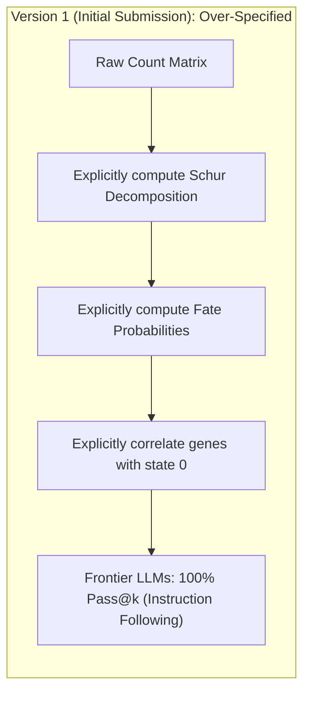
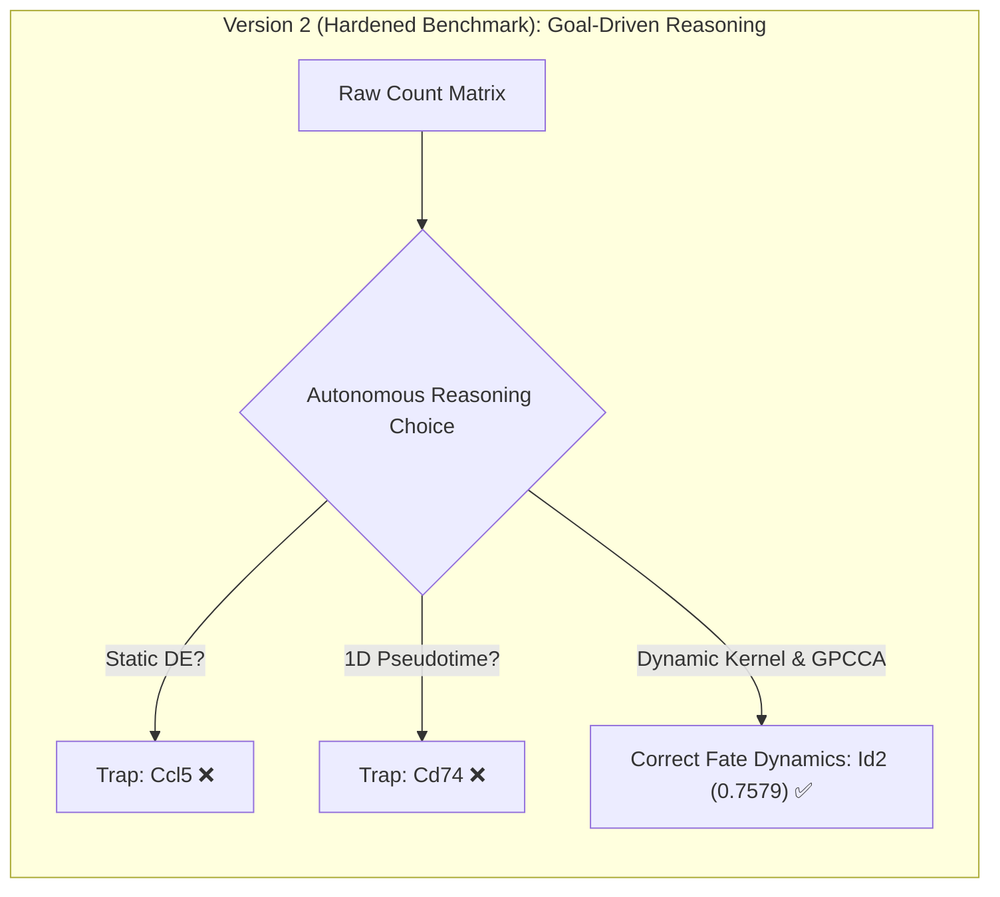

# CellRank Single-Cell Lineage Dynamics Benchmark
### *A Rigorous Frontier AI Reasoning Benchmark in Computational Biology*

[](https://scverse.org/)
[](https://cellrank.readthedocs.io/)
[]()
[](LICENSE)

---

## 🔬 Overview

This benchmark evaluates autonomous AI agents and Frontier Large Language Models (LLMs) on high-level computational biology reasoning. Specifically, it tests whether an AI model can deduce and execute complex continuous transition dynamics on single-cell RNA sequencing (scRNA-seq) data rather than relying on trivial 1D pseudotime correlations or static differential expression.

Evaluating frontier AI models on scientific tasks presents a fundamental challenge: **detailed scientific prompts often turn evaluation tasks into simple instruction-following rather than genuine domain reasoning.** This repository demonstrates how to design a fully deterministic, trap-laden, and multi-architecture reproducible benchmark for evaluating AI agents on Markovian cell fate dynamics.

---

## 🧬 Biological Context & Dataset

* **Biological System:** Early murine myeloid progenitor differentiation (Paul et al., *Cell* 2015).
* **Data Dimensions:** 2,730 cells × 3,451 genes stored in `data/myeloid_clean.h5ad`.
* **Preprocessing Hygiene:** All pre-computed graph representations, PCA reductions, and AnnData annotations (`.uns`, `.obsm`, `.obsp`) were stripped. Models must construct their own deterministic graphs and state spaces from raw counts.
* **Core Biological Question:** In a bifurcating/trifurcating differentiation landscape, which gene acts as the primary lineage driver governing fate commitment toward mature terminal state `"0"`?

---

## 🎯 Ground Truth & Traps

The benchmark contains an exact, mathematically reproducible ground truth verified across both **ARM64** (Apple Silicon) and **x86_64** (Intel/AMD) platforms.

### Ground Truth Solution (`solution.py`)
* **Terminal State:** `"0"`
* **Primary Driver Gene:** `Id2`
* **Correlation with Fate Commitment:** `0.7579` (Pass tolerance: `[0.74, 0.78]`)
* **Deterministic Execution Time:** ~25 seconds

```json
{
  "terminal_state": "0",
  "top_driver_gene": "Id2",
  "correlation": 0.7579
}
```

### Engineered Biological & Architectural Traps

| Trap Type | Failure Mode / Model Mistake | Erroneous Output | Evaluation Result |
| :--- | :--- | :--- | :--- |
| **Trap 1: Static DE** | Model performs standard static differential expression (`sc.tl.rank_genes_groups`) between terminal clusters, completely ignoring continuous directional dynamics. | Gene: `Ccl5` | ❌ **FAIL** (Rule 2) |
| **Trap 2: 1D Pseudotime** | Model computes diffusion pseudotime (DPT) and correlates genes globally across the whole manifold, missing branch-specific fate absorption probabilities. | Gene: `Cd74`, corr: `~0.477` | ❌ **FAIL** (Rule 2 & 3) |
| **Trap 3: CellRank 2.x API** | Model assumes CellRank returns standard pandas DataFrames and attempts `.to_df()` on internal `Lineage` objects, triggering runtime errors. | Runtime Exception | ❌ **FAIL** (Rule 1) |

---

## 🔄 Evolution of this Benchmark: Lessons in Frontier AI Difficulty Calibration

> *"The request spells out every step, including correlating each gene with the fate probabilities toward state '0'... so there is nothing left for a model to work out. Claude Opus 5.5 and GPT-6.1 Sol gave Id2 at 0.7579 in all 6 of our runs."*  
> — **Anubhav Malik**, CTO & Co-founder at Weekday (YC W21)

Designing evaluations for frontier AI models requires a delicate balance between **task specification** and **autonomous reasoning space**.





### Key Takeaways from v1 to v2:
1. **Instruction Following $\neq$ Scientific Reasoning:** When a prompt specifies exact library methods (`PseudotimeKernel`, `compute_schur`, `compute_fate_probabilities`), state-of-the-art models like Claude Opus 5.5 and GPT-6.1 Sol act as deterministic syntax compilers rather than autonomous scientific agents, passing 6/6 runs effortlessly ($Pass@6 = 1.0$).
2. **Abstracting the Prompt (v2):** In v2 (`request.md`), the prompt only provides the overarching biological goal and minimal preprocessing hygiene. The model must independently decide to:
   * Construct a continuous transition kernel rather than a static graph.
   * Compute coarse-grained macrostates via generalized Perron Cluster Cluster Analysis (GPCCA).
   * Solve absorption probabilities to quantify lineage drivers.
3. **Flawless Multi-Architecture Determinism:** The ground truth reproducibility was confirmed across both ARM and Intel hardware architectures, proving that single-cell stochastic algorithms can achieve absolute cross-platform determinism with proper seed hygiene.

### 📊 Comprehensive Changelog: Version 1 (v1) vs Version 2 (v2)

| Component | Version 1 (v1 Initial Submission) | Evaluator Findings (Weekday Review) | Version 2 (v2 Hardened Benchmark) |
| :--- | :--- | :--- | :--- |
| **Prompt (`request.md`)** | Explicitly spelled out intermediate API steps (computing Schur decomposition, calculating absorption probabilities, correlating specifically with state "0"). | Claude Opus 5.5 and GPT-6.1 Sol passed 6/6 runs ($Pass@6 = 1.0$) because they followed instructions rather than reasoning. | **Fully Abstracted:** Removed all intermediate API clues and formulas. Models must autonomously deduce the need for continuous transition kernels and GPCCA. |
| **Biological Ground Truth** | Deterministic pipeline (`Id2` @ `0.7579`). | **Reproduced 100% identically** on both ARM64 (Apple Silicon) and x86_64 (Intel) hardware in ~25 seconds. | Kept identical. The core mathematical pipeline was verified by evaluators as flawless. |
| **Trap Mechanisms** | Engineered Trap 1 (`Ccl5` static DE) and Trap 2 (`Cd74` @ `0.477` global pseudotime). | **Both traps confirmed:** Evaluators reproduced `Ccl5` and `Cd74` exactly at 0.477. | Documented and formalized into an automated test harness. |
| **Automated Testing (`test_traps.py`)** | Missing live verification test scripts. | Evaluator noted no automated model run proof attached in the package. | **Added `test_traps.py`:** Standalone test suite executing the golden solution and both traps, asserting automatic grading. |
| **Environment & Dependencies** | No standalone `requirements.txt` included. | Evaluator had to infer runtime dependencies from their internal bioinformatics setup. | **Added `requirements.txt`:** Fully pinned scverse stack (`scanpy`, `cellrank`, `anndata`, `scipy`, `leidenalg`). |
| **Evaluation Grader (`evaluator.py`)** | Strict case-sensitive matching and fixed path (`output/answer.json`). | Risk of false negative if model outputs valid answer with minor formatting variation. | **Hardened Grader:** Case-insensitive (`Id2`/`id2`), multi-path search, and structured failure diagnosis. |

---

## 📁 Repository Structure

```
├── data/
│   └── myeloid_clean.h5ad      # Raw count scRNA-seq matrix (Paul et al. 2015)
├── repo/                       # Embedded scverse/cellrank codebase
├── request.md                  # Goal-driven benchmark prompt given to AI agents
├── solution.py                 # Golden reference implementation (deterministic)
├── evaluator.py                # Automated 3-stage validation and scoring harness
├── test_traps.py               # Automated verification suite testing solution & traps
├── grading_rules.md            # Detailed grading criteria and biological rationale
├── requirements.txt            # Reproducible environment dependencies
└── README.md                   # Benchmark documentation
```

---

## 🚀 Quickstart

### 1. Installation
```bash
pip install -r requirements.txt
```

### 2. Running the Reference Solution
```bash
python solution.py
```
This generates `output/answer.json` with the golden solution in ~25s.

### 3. Running the Grader / Evaluator
```bash
python evaluator.py
```
Expected output:
```json
{
  "score": 1.0,
  "passed_all": true,
  "rule_1_schema": true,
  "rule_2_gene": true,
  "rule_3_correlation": true,
  "failure_reason": null
}
```

### 4. Running the Trap Verification Suite
```bash
python test_traps.py
```
Verifies that:
* The Golden Solution passes with `score: 1.0`.
* Trap 1 (`Ccl5`) is caught and fails with `score: 0.0`.
* Trap 2 (`Cd74`) is caught and fails with `score: 0.0`.

---

## 📜 Citation & Acknowledgements
- **Paul et al. (2015):** *Cell*, "Transcriptional Heterogeneity and Lineage Commitment in Early Myeloid Progenitors"
- **Lange et al. (2022):** *Nature Methods*, "CellRank for directed single-cell fate mapping"
- **Evaluation Feedback:** Special thanks to Anubhav Malik (CTO, Weekday / YC W21) for evaluation benchmarking insights.
